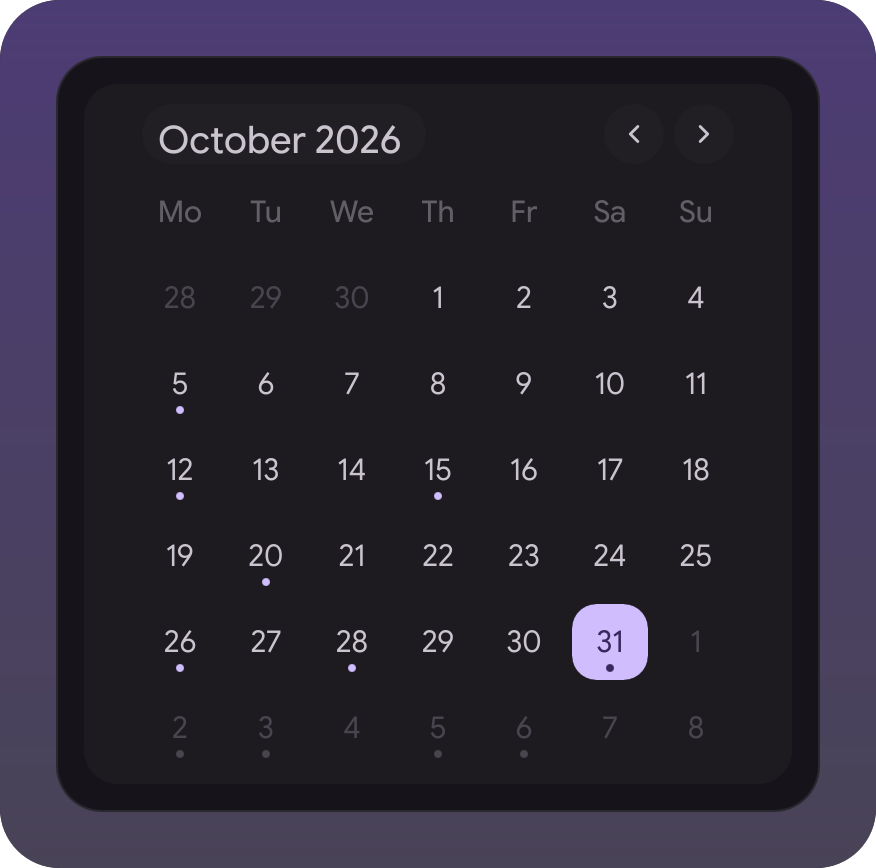
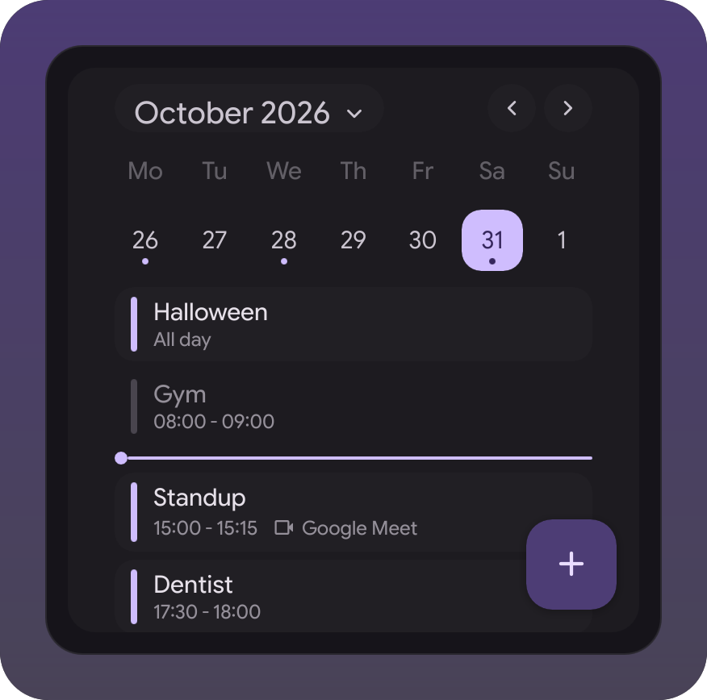
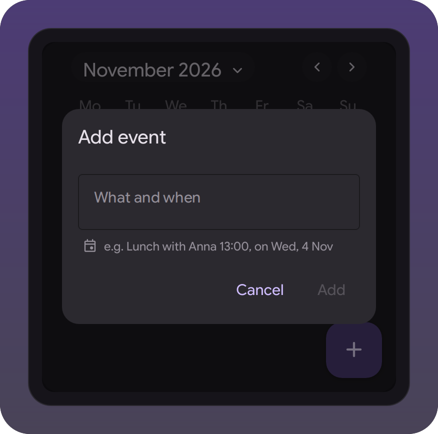
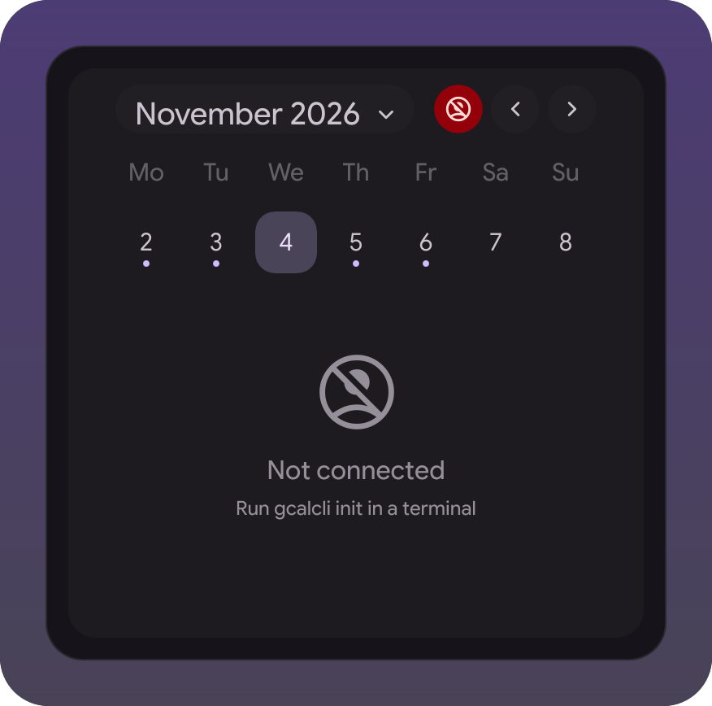

# Calendar widget

Calendar events in the Calendar tab of the right sidebar, for the
[illogical-impulse extensions fork](https://github.com/Berupor/dots-hyprland-extensions).
The month grid gets a dot under every day with events; click a day and the
month folds to its week with that day's events below, click the month name to
unfold it. The + button adds an event in the provider's quick-add syntax.
Events come from a provider picked in the options; gcalcli (Google Calendar)
is the only one so far.

| Month | Day | Add | Not connected |
|---|---|---|---|
|  |  |  |  |

## Setup: gcalcli

Talks to Google through [gcalcli](https://github.com/insanum/gcalcli), which
has to be installed and signed in once from a terminal:

```sh
uv tool install gcalcli
gcalcli init
```

`gcalcli init` asks for an OAuth client of your own, see gcalcli's
[api-auth.md](https://github.com/insanum/gcalcli/blob/HEAD/docs/api-auth.md).
The widget never reads the token, it only runs `gcalcli agenda` and
`gcalcli quick`. Until gcalcli is installed and signed in the tab says what
to run instead of showing a blank day.

## How it works

- Events of the six weeks on screen and two months around them are fetched
  in one provider run, so nearby months show instantly. It runs again when
  you leave that window, after adding, and every few minutes while the tab is
  open; opening the tab refetches if the data is older than that. A failed run
  keeps the last events and turns the header into a retry button, signing out
  clears them.
- All-day events come first, finished ones are dimmed, today has a line at the
  current time. Clicking an event opens it in the browser.
- Scroll changes the month. The arrows and PageUp/PageDown change the month,
  or the week once a day is open.
- With gcalcli, adding passes the text to `gcalcli quick`. Google reads days
  only in English: "friday 5pm", "May 3", "next week" are left to it, text
  without a day ("Lunch with Anna 13:00") gets "on" and the picked day
  appended. Russian day phrases ("завтра", "в пятницу", "3 ноября",
  "через 3 дня", "10.11.2026") are replaced with the English date. The dialog
  shows which day and time the event lands on ("all day" when the text has no
  time).

## Options

- Provider, `gcalcli` by default.
- Hidden calendars: names as the provider lists them, comma-separated.
- Refresh interval in minutes, 10 by default.
- Calendar for new events. Empty means the first calendar you own.

## Adding a provider

A provider is `providers/<Name>.qml` plus a line in the `providers` map of
`calendar.js`. Its root is a `Scope` with:

- `fetch(window)`, window being `"start end"` iso days, answered once by
  `fetched(window, rows, failure)`. `rows` is null on failure; `failure` is
  `{ setup, text, exitCode }`, `setup` meaning not installed or not signed in
  (events are cleared and `text` says what to run).
- `canAdd`, `add(text, day, calendar)` answered by `added()` or
  `addFailed(failure)`, and `plan(text, day, now)` returning
  `{ text, day }` for the dialog preview (`day` null when the text names its own).
- Rows shaped `{ key, title, calendar, link, call, allDay, startText, endText,
  start, end }`: `call` is a label like "Google Meet" or empty, `start`/`end`
  are epoch ms.

`providers/Gcalcli.qml` is the one to copy.

## Files

| File | What it is there for |
|---|---|
| `Manifest.qml` | id, slot, options |
| `CalendarTab.qml` | the `calendarView` slot: grid, day list, add dialog |
| `MonthGrid.qml`, `DayButton.qml`, `HeaderButton.qml` | the grid and its header |
| `EventList.qml` | a day's events, or what is missing |
| `AddEventLayer.qml` | the + button and the dialog |
| `EventsState.qml` + `qmldir` | the singleton: provider, fetch window, polling |
| `calendar.js` | dates, the grid, grouping by day, the provider map |
| `providers/` | gcalcli: running it, parsing, quick-add rules |
| `demo/` | the scene for the tests and the pictures, on stub events |

## Working on it

```sh
tests/widget-probe.sh calendar calendarView -x ~/Projects/ii-widget-gcal -H sidebar -g 354x350 -p surface=true
tests/qml-cases.sh    -x ~/Projects/ii-widget-gcal
tests/widget-shots.sh -x ~/Projects/ii-widget-gcal
```

`-p selected=2026-11-04` opens a day, `-p status=setup` or `error` draws
the other states. `git config core.hooksPath .githooks` runs the cases and
redraws the shots on push.

## Install

Settings → Widgets → Install a widget, paste:

```
https://github.com/Berupor/ii-widget-gcal.git
```

Needs shell contract 1.6, which added the `calendarView` slot.

GPL-3.0, same as the shell it plugs into.
